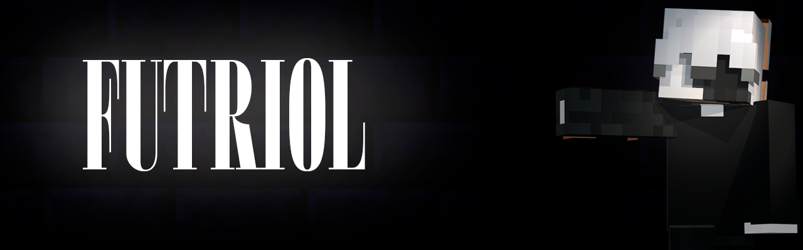

# FUTRIOL

### Разработчик • Программирование • Технологии

Изучаю, экспериментирую и превращаю идеи в реальные проекты.

---

## 👋 Обо мне

Привет! Я Futriol — начинающий разработчик, интересующийся программированием, современными технологиями и созданием собственных цифровых проектов.

Мне нравится не просто пользоваться готовыми решениями, а разбираться в том, как они устроены, экспериментировать с разными инструментами и искать интересные способы реализации своих идей.

Основное внимание уделяю программированию, веб-разработке и созданию интерактивных проектов. Также интересуюсь игровой разработкой и созданием собственных игровых механик в Roblox Studio.

Постоянно стараюсь узнавать что-то новое, улучшать свои навыки и пробовать себя в разных направлениях.

## 💡 Мои интересы

- 💻 Программирование — изучение языков, алгоритмов и логики разработки.
- 🌐 Веб-разработка — создание сайтов, интерактивных страниц и современных интерфейсов.
- 🎮 Игровая разработка — создание игровых механик, систем и эксперименты в Roblox Studio.
- 🎨 UI/UX и дизайн — работа над внешним видом и удобством цифровых продуктов.
- ⚙️ Автоматизация — разработка небольших инструментов и полезных решений.
- 🚀 Технологии — изучение новых инструментов и возможностей разработки.

## 🛠 Технологии и инструменты

## 🚀 Мои проекты

Мне нравится работать над разными идеями и постепенно превращать их в полноценные проекты.

Среди направлений, которыми я занимаюсь:

- Интерактивные сайты и веб-приложения.
- Собственные инструменты и небольшие программы.
- Игровые проекты и системы на Lua / Luau.
- Разработка механик и интерфейсов в Roblox Studio.
- Экспериментальные проекты с использованием новых технологий.

## 📚 Сейчас развиваюсь в

- Изучении JavaScript и веб-разработки.
- Улучшении навыков Lua / Luau.
- Создании более сложных и удобных интерфейсов.
- Архитектуре и оптимизации программ.
- Разработке собственных игровых проектов.

## 📊 GitHub Statistics

---

### BUILD • CREATE • IMPROVE

*От идеи до реализации — шаг за шагом.*

